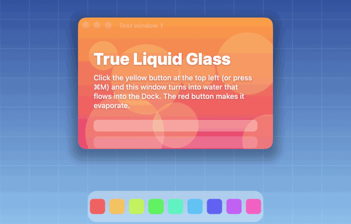
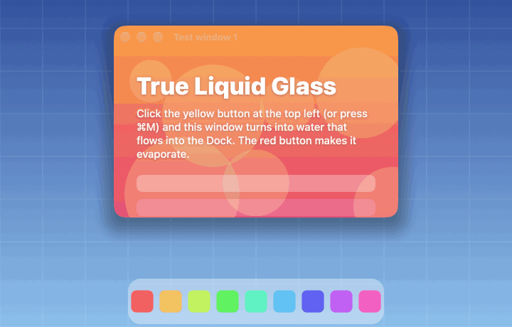
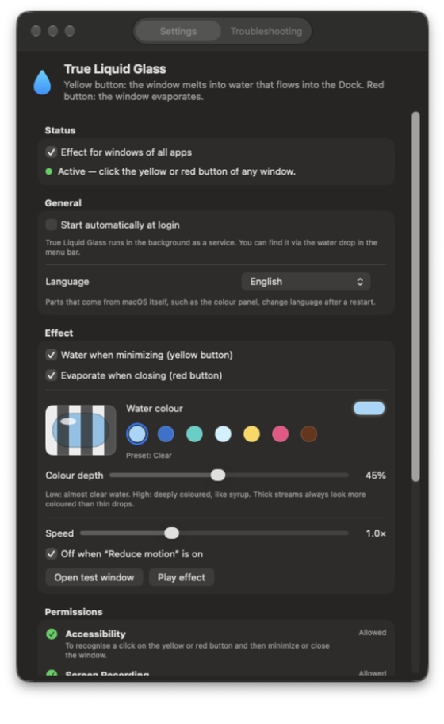
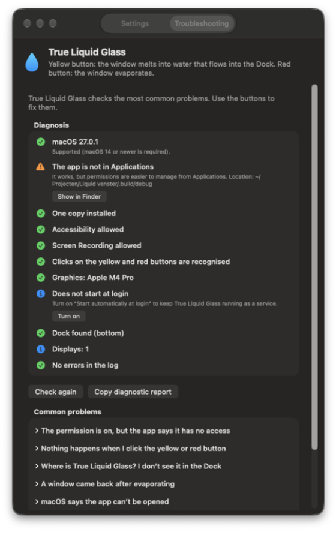

# True Liquid Glass 💧

**[⬇ Download the installer (latest release)](https://github.com/EduardWichers/true-liquid-glass/releases/latest)** · Created by **[Eduard Wichers](https://github.com/EduardWichers)**

| Yellow button: water | Red button: steam |
|:---:|:---:|
|  |  |

A macOS app (macOS 14 Sonoma or newer, Apple silicon and Intel) that turns the window buttons into water:

- **Yellow button – water.** The window first becomes wet and glassy. It then melts from the bottom up and drips, falls onto the Dock as a waterfall, splashes, and runs as a thin film into the Dock icon.
- **Red button – steam.** The window heats up and shimmers in its own heat haze. It evaporates from the edges inwards, and wisps of steam rise and drift away.

The water colour is up to you: pick any colour or a preset (Clear, Sea, Lagoon, Glacier, Lemonade, Raspberry, Cola), and choose how deep the colour is.

The app runs in the background as a service: there is no Dock icon, only a water drop in the menu bar, and it starts automatically at login. It is available in **10 languages**: English, Nederlands, Deutsch, Français, Español, Português (Brasil), Italiano, Русский, 简体中文 and 日本語. By default it follows the macOS language; you can also choose one in the app.

---

## Installing (for users)

1. Open the **[latest release](https://github.com/EduardWichers/true-liquid-glass/releases/latest)**, expand **Assets** and download **`TrueLiquidGlass-<version>-Installer.pkg`**.
   (The green *Code › Download ZIP* button only contains the source code, not the installer.)
2. Double-click the downloaded `.pkg` and follow the steps (Continue → Install). The installer explains everything in your own language.
3. The app opens automatically. Click **Allow…** next to *Accessibility* and *Screen Recording*, turn True Liquid Glass on in System Settings, then click **Restart True Liquid Glass**.
4. Click the yellow or red button of any window.

> **"Apple could not verify … is free of malware"?** The package is not signed with an Apple Developer ID, so macOS blocks it after downloading. Click **Done**, open **System Settings › Privacy & Security**, scroll down to **Security** and click **Open Anyway** next to the installer's name; confirm with your password or Touch ID and choose **Open**. Do this within about an hour of the warning. (On recent macOS versions right-click › Open no longer bypasses this.)

### What the permissions are for

| Permission | Why |
|---|---|
| Accessibility | To recognise a click on the yellow/red button, intercept it, and then minimize or close the window itself. |
| Screen Recording | To take a snapshot of the window and the screen behind it; the water and steam are made from that. |

The app's own test windows work without any permissions. Everything happens on your Mac; nothing is sent over the internet.

---

## Screenshots

| Settings | Troubleshooting |
|:---:|:---:|
|  |  |

---

## Troubleshooting

The app has a **Troubleshooting** tab (menu bar drop › *Troubleshooting…*). It checks everything automatically, has buttons for the fixes, and can copy a diagnostic report to the clipboard (always in English, handy for support).

| Problem | Solution |
|---|---|
| **Permission is on, but the app says it has no access** | The entry belongs to an older version. Use *Reset permissions…* in the Troubleshooting tab, or remove True Liquid Glass with **−** in System Settings › Privacy & Security (Accessibility and Screen Recording) and allow it again. |
| **Nothing happens when I click the yellow/red button** | Check the diagnosis. Windows in full screen, windows spread over two displays, clicks with ⌘/⌥/⌃/⇧ held down and apps with their own title bar get the normal animation. In other apps only the buttons are used, not ⌘M/⌘W. Also check that "Reduce motion" is off, or let the app ignore it. |
| **Screen Recording is on but doesn't work** | Restart the app (*Restart True Liquid Glass* button). macOS only applies this permission after a restart. |
| **macOS says the installer or app can't be opened** | System Settings › Privacy & Security › scroll down to Security › **Open Anyway**, then confirm. (Right-click › Open no longer works on recent macOS.) |
| **"The app runs from a temporary location"** | macOS started a protected copy (App Translocation). Move the app to Applications and open it from there. |
| **Where is the app? It's not in the Dock** | It runs in the background as a service. Click the water drop in the menu bar, or open the app again from Applications. |
| **A window came back after evaporating** | The app asked something before closing (e.g. "save changes?"). The window then stays open so you can answer. |
| **The water flows to the wrong place** | The water flows to the app's Dock icon. If the Dock is hidden or on another display, it flows to the nearest screen edge. Without Accessibility the Dock position is estimated. |
| **The screen seems to freeze for a moment** | Normal: during the animation (about 1.5 s) you see a still image of the screen. Make it faster with *Speed*. |
| **The app does not start at login** | Settings › General › *Start automatically at login*. If macOS asks for approval: System Settings › General › Login Items. |
| **Still stuck?** | Troubleshooting tab › *Copy diagnostic report*, and paste the report in an issue. The log is also in Console.app (subsystem `nl.liquidvenster.app`). |

### Uninstalling

Quit the app (menu bar drop › *Quit*), move **True Liquid Glass** from Applications to the Trash, and remove it under Accessibility and Screen Recording in System Settings › Privacy & Security (and under General › Login Items if it is still listed).

---

## Building from source (for developers)

You only need the Xcode Command Line Tools (`xcode-select --install`), not full Xcode.

```bash
./build.sh             # universal release build + self-test → build/True Liquid Glass.app
./build.sh --package   # also: build/True Liquid Glass Installer.pkg
./build.sh --install   # also: install into /Applications (older version → Trash)
```

- **Self-test** (159 checks, runs during every build): geometry, animation physics, real GPU frames (water and steam, light and transparent), colours, all 10 languages (complete and with matching placeholders), installer pages, diagnostics and settings.
  `.build/release/LiquidVenster --selftest --output /tmp/frames` also saves sample frames.
- **README images**: `.build/release/LiquidVenster --make-screenshots docs --language en` captures the real settings window and renders `water.gif` / `steam.gif` over a synthetic desktop (nothing from your own screen).
- **Live demo**: `"build/True Liquid Glass.app/Contents/MacOS/TrueLiquidGlass" --demo 3 --quit-after --verbose` minimizes a test window 3× and evaporates one.
- **Installer**: `Scripts/make_installer.sh` builds a `.pkg` with `pkgbuild`/`productbuild`. The welcome and conclusion pages are generated by the app itself (`--installer-pages`) from the same translation tables. The package installs into `/Applications` (not relocatable), quits a running copy, moves the old "Liquid Venster.app" to the Trash and opens the app afterwards.
- **Translations** live in `Sources/LiquidVenster/Strings+<language>.swift`; the English table is the reference.

### Fixed signature

The first build creates a self-signed certificate *Liquid Venster Ontwikkelaar* in a separate keychain: `~/Library/Application Support/Liquid Venster/signing.keychain-db` (password in `signing.pass`, readable only by you). Every build gets the same signature, so macOS keeps the permissions after an update. Your login keychain and keychain search list are not touched. Don't share that folder: anyone with it can sign apps that macOS treats as this app. For an ad-hoc signature: `LIQUID_ADHOC=1 ./build.sh`.

The package itself is not signed with an Apple Developer ID and is not notarized, so after downloading it macOS asks for *Open Anyway* once (see above).

### How it works

1. An *event tap* watches left clicks. A click on an enabled yellow/red button of another app (found via Accessibility) is intercepted; any other click passes through.
2. ScreenCaptureKit captures the window (without shadow) and the screen without the window (the "clean plate").
3. A click-through overlay puts both exactly over the real window; the first frame is pixel-identical to what was on screen. The real window is then minimized or closed underneath in the normal way (by "pressing" its button, so the app's own logic such as "save changes?" still runs).
4. Metal renders the effect from 9,000–42,000 particles: water as a metaball height field with refraction, Beer–Lambert colour absorption, Fresnel reflection, glints and caustics; steam as soft, buoyant, swirling puffs with heat haze.
5. Safety nets: the click is never lost (fallback to the normal action), a watchdog, an abort if no frames are drawn within 0.5 s (locked screen), and an abort on display or Space changes. The red button also gets a check: if the window is still there after 0.5 s (the app is asking something), the overlay steps aside.

---

## Credits

**True Liquid Glass** is created by **[Eduard Wichers](https://github.com/EduardWichers)**.

© 2026 Eduard Wichers. All rights reserved.
